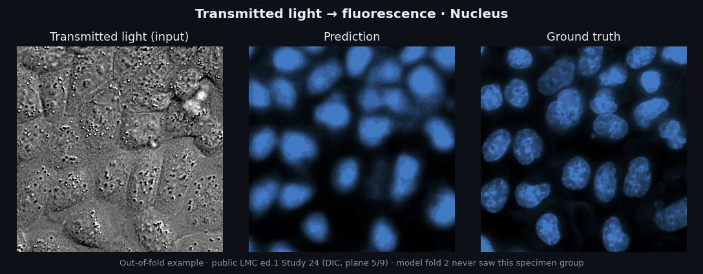
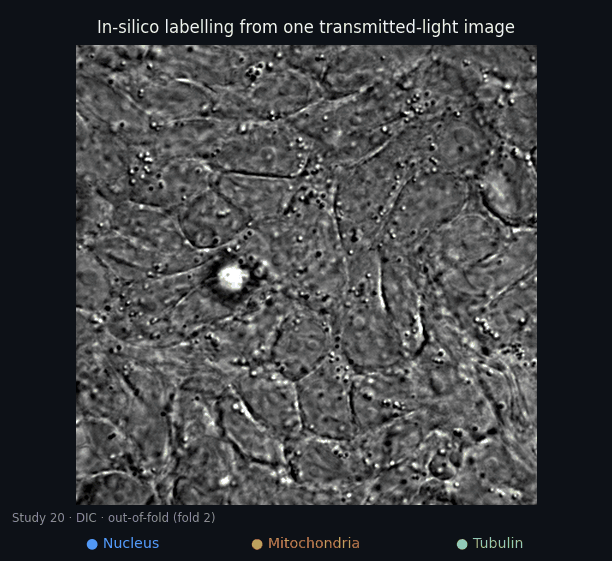
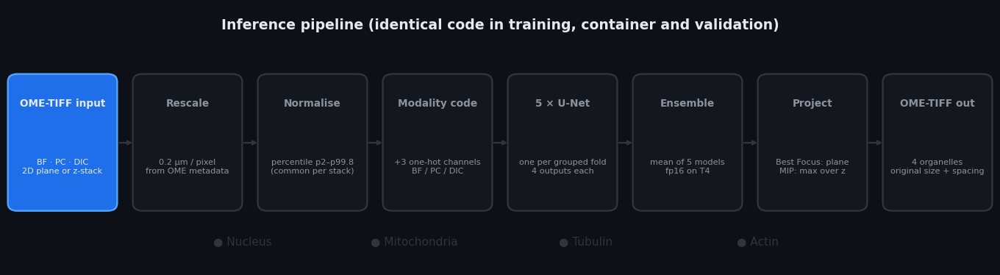
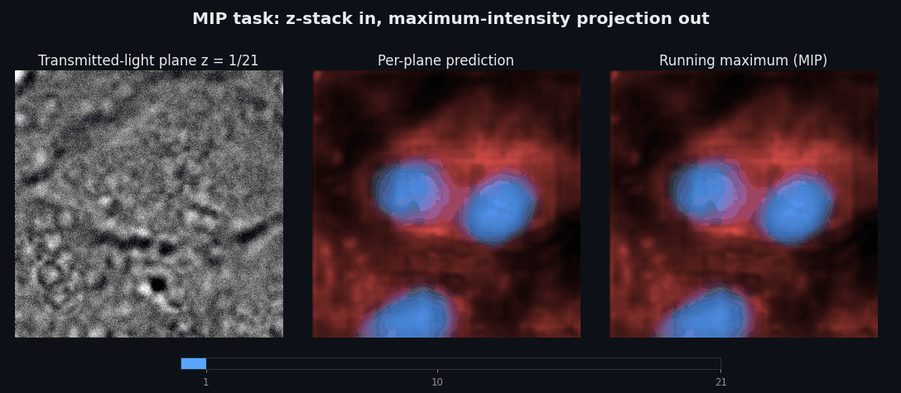
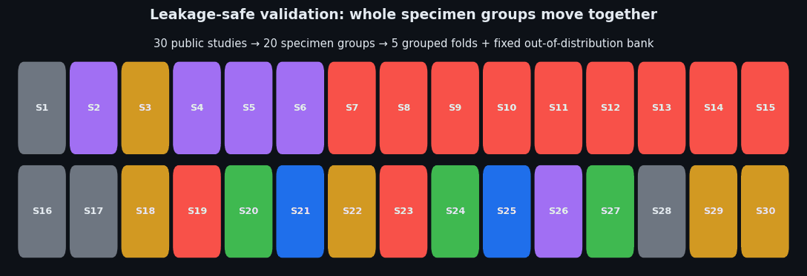
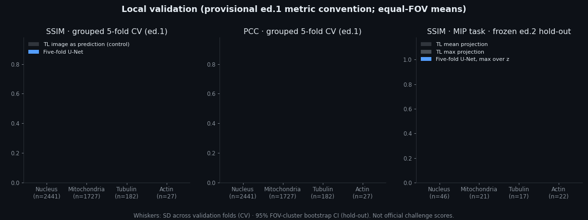

<div align="center">

# Light My Cells 2 · Modality-Aware Five-Fold U-Net

**In-silico fluorescence labelling of nucleus, mitochondria, tubulin and actin from transmitted-light microscopy (bright-field, phase contrast, DIC), for both the Best Focus and the MIP tasks of the [Light My Cells 2 challenge](https://lightmycells2.grand-challenge.org/).**

[](https://github.com/Agnuxo1/LightMyCells2-ModalityAware-UNet/actions/workflows/ci.yml)




<sub>Out-of-fold example on public data: the fold-2 model never saw this specimen group during training. Each frame shows one organelle.</sub>

</div>

---

## Highlights

**28 October: three new MIP aggregation experiments on real images.** A
hash-selected seven-FOV pilot compared mean, half-max/half-mean and logmeanexp
aggregation with the frozen five-model maximum projection. The half blend has
an equal-FOV SSIM delta **+0.000332** (95% exploratory bootstrap
[-0.002976,+0.004014]) and PCC delta **+0.001109**. Three FOV improve and four
worsen on SSIM. Mean and logmeanexp have SSIM deltas -0.007307 and -0.009376.
All per-FOV gains and regressions are preserved. These previously evaluated
images are an exploratory pilot; they do not justify replacing the frozen
baseline. [Full results and scope](evidence/mip-pilot-20261028/SUMMARY.md).

All **80 measurement rows** survived a missing-pandas error in the GPU job's
summary stage. They were recovered without repeating inference; the standalone
summary and updated GPU runner now use the Python standard library for
aggregation. The reproduced maximum control agrees with archived SSIM within
0.000008631. Reproduce the evidence summary with
`python tools/summarize_mip_pilot.py`.

- **One model family, every modality.** A single four-output U-Net receives the transmitted-light image plus a bright-field / phase-contrast / DIC code, so one network serves all three microscopes and all four organelles.
- **Large gains over the transmitted-light control.** In leakage-safe grouped cross-validation on the public edition-1 data, nucleus SSIM rises from 0.085 (transmitted light used as the prediction) to **0.564**, and PCC from 0.041 to **0.538**. Every organelle beats the control on both metrics.
- **Strong MIP transfer without MIP training.** On a frozen hold-out cohort of 46 fields of view from seven edition-2 studies, the ensemble's maximum-over-planes projection reaches SSIM **0.62–0.71** and PCC **0.50–0.76** across organelles. The best transmitted-light projection reaches SSIM 0.22–0.38 and PCC 0.12–0.28.
- **Stable out-of-distribution behaviour.** On a fixed bank of four never-trained studies, the five fold models agree closely (nucleus SSIM 0.663 ± 0.014).
- **Fast and light.** A 2048 × 2048 Best Focus case runs in 2.6 s, and a 16-plane MIP stack in 9.0 s (RTX 3090, 476 MiB peak GPU memory). The challenge allows 300 s per case.
- **Platform-validated.** The self-contained container passed the official **Best Focus mock** on Grand Challenge (evaluation status *Succeeded*, 28 October 2026).
- **Auditable end to end.** The repository holds frozen splits with canonical hashes, all 15,532 per-image evaluation rows, an independent metric re-implementation that agrees with SciPy/scikit-image to 1.3 × 10⁻¹⁴, negative controls, and container receipts.

## Contents

| | |
|---|---|
| [The task](#the-task) | [Validation](#validation-protocol) |
| [Method](#method) | [Results](#results) |
| [MIP task](#mip-task) | [Reproducing](#reproducing) |
| [Container](#grand-challenge-container) | [Limitations](#limitations-and-scope) |

## The task

Fluorescence microscopy reveals organelles but needs labelling, phototoxic light and multiple channels. Transmitted-light microscopy is cheap and gentle but shows little molecular contrast. The Light My Cells 2 challenge, organised by France-BioImaging, asks for algorithms that predict the fluorescence images of four organelles directly from transmitted light:

- **Best Focus:** one 2D transmitted-light image in, four best-focus fluorescence images out.
- **MIP:** a transmitted-light z-stack in, four maximum-intensity projections of fluorescence out.

Submissions run offline in a Docker container on a CPU or an NVIDIA T4, with a 300 s per-case limit. Predictions are compared with SSIM, PCC, MAE, cosine distance and Euclidean distance after independent 2nd–99.8th percentile normalisation of prediction and ground truth.

<div align="center">

</div>

## Method



1. **Read** a single-channel OME-TIFF (2D plane or ZYX stack). Modality comes from the OME channel name, and physical pixel size from `PhysicalSizeX/Y`. Ambiguous or missing metadata fails loudly instead of being guessed.
2. **Resample** to a common 0.2 µm/pixel, so that magnification differences between microscopes become a single physical scale.
3. **Normalise** intensities with the 2nd and 99.8th percentiles, without clipping. MIP stacks share one normalisation for the whole stack.
4. **Encode the modality** as three one-hot channels (BF, PC, DIC) appended to the image.
5. **Predict** with five U-Nets (4 levels, base width 32, GroupNorm + SiLU, 7.77 M parameters each). Each one was trained for 20,000 iterations with label-masked L1 loss on one grouped fold split, so missing organelles never contribute gradients.
6. **Ensemble** by averaging the five predictions (fp16 on GPU, fp32 on CPU).
7. **Project and write.** For Best Focus the plane prediction is returned. For MIP the per-plane ensemble predictions are combined with a pixel-wise maximum. Four float32 OME-TIFFs are written at the input size, with the original filename, physical spacing and matching TIFF resolution tags.

Training, the challenge container and every validation script import the same `lmc_model.py` and `lmc_common.py`, so preprocessing cannot drift between them. Details are in [docs/METHOD.md](docs/METHOD.md).

## MIP task



The submitted MIP method reuses the frozen Best Focus ensemble. It normalises the whole transmitted-light stack once, predicts every plane, and takes the maximum over z. This needs no extra training data and keeps one validated model for both tasks.

We also trained two direct-MIP variants (masked L1, and L1 + 0.2·SSIM) on 33 development fields of view. We compared them with the frozen ensemble on a reserved 46-FOV cohort that was fixed before any of its images or outcomes were inspected. The direct models raised nucleus SSIM slightly, but lowered mitochondria, tubulin and actin. The frozen ensemble therefore stays the submitted method, and the experiment is kept in [`src/mip_supervised/`](src/mip_supervised) as a documented negative result.

## Validation protocol



- **Grouped five-fold cross-validation.** The 30 public studies (S-BIAD1047, 56,984 TIFFs, 109.3 GB) are linked into 20 connected specimen groups, and each group lives in exactly one fold. Validation folds contain 1,312 / 648 / 243 / 126 / 112 fields of view.
- **Fixed out-of-distribution bank.** Studies 1, 16, 17 and 28 (133 FOVs) are never used for training or selection.
- **Frozen before results.** The split is versioned with a canonical SHA-256 (`1cab58ff…cbc`), seeded (2026), and never regenerated after outcomes were observed. Amendments are recorded in [docs/VALIDATION.md](docs/VALIDATION.md).
- **Estimand.** Planes are averaged within modality, modalities within field of view, and then every field of view gets equal weight. Equal-study and per-fold views are reported separately.
- **Metric fidelity.** SSIM and PCC follow the first-edition convention, which the organisers confirmed for edition 2: independent float percentile normalisation (2–99.8) without clipping. A second implementation agrees with SciPy/scikit-image on raw images within 1.3 × 10⁻¹⁴.
- **Data integrity.** All 56,984 TIFFs decode with the expected sizes and finite pixels. One all-zero tubulin reference has undefined SSIM/PCC; it is reported in the denominator and not imputed.

## Results



**Grouped cross-validation, edition-1 public data (equal-FOV means; ± SD across validation folds)**

| Organelle | FOV | SSIM | PCC | Control SSIM | Control PCC |
|---|---:|---:|---:|---:|---:|
| Nucleus | 2,441 | **0.564** ± 0.121 | **0.538** ± 0.121 | 0.085 | 0.041 |
| Mitochondria | 1,727 | **0.435** ± 0.128 | **0.446** ± 0.169 | 0.105 | 0.038 |
| Tubulin | 182 | **0.371** ± 0.139 | **0.369** ± 0.248 | 0.300 | 0.097 |
| Actin | 27 | **0.397** ± 0.011 | **0.378** ± 0.054 | 0.083 | 0.007 |

*Control: the transmitted-light image itself scored as the prediction. Equal-study means are higher for nucleus (SSIM 0.666) and mitochondria (0.588).*

**Out-of-distribution bank (4 unseen studies; mean ± SD over the five fold models)**

| Organelle | FOV | SSIM | PCC |
|---|---:|---:|---:|
| Nucleus | 92 | **0.663** ± 0.014 | 0.450 ± 0.021 |
| Mitochondria | 92 | **0.487** ± 0.013 | 0.427 ± 0.017 |
| Tubulin | 41 | **0.608** ± 0.017 | 0.573 ± 0.040 |

**MIP task, frozen edition-2 hold-out (46 FOV, 7 studies; equal-FOV means; 95% FOV-cluster bootstrap CI)**

| Organelle | FOV | Ensemble SSIM | Ensemble PCC | Best TL projection SSIM | Best TL projection PCC |
|---|---:|---:|---:|---:|---:|
| Nucleus | 46 | **0.623** [0.49, 0.75] | **0.725** | 0.224 | 0.123 |
| Mitochondria | 21 | **0.708** [0.66, 0.79] | **0.764** | 0.327 | 0.277 |
| Tubulin | 17 | **0.663** [0.48, 0.80] | **0.706** | 0.302 | 0.180 |
| Actin | 22 | **0.625** [0.59, 0.65] | **0.499** | 0.377 | 0.130 |

All numbers come from the archived CSVs in [`evidence/`](evidence) and can be regenerated with `tools/reproduce_audit.py`. They are local validation figures, not official challenge scores.

## Grand Challenge container

| | |
|---|---|
| Interface | Grand Challenge *invoke* API (`/health`, `/invoke`), label `org.grand-challenge.api-method="invoke"` |
| Input socket | `images/organelles-transmitted-light-ome-tiff` |
| Best Focus outputs | `images/{nucleus,mitochondria,tubulin,actin}-fluorescence-ome-tiff` |
| MIP outputs | `images/mip-{nucleus,mitochondria,tubulin,actin}-fluorescence-ome-tiff` |
| Runtime | PyTorch 2.13 + CUDA 12.6 (sm75 for T4); exact lock in [docs/container-requirements.lock.txt](docs/container-requirements.lock.txt) |
| Offline | all five checkpoints embedded under `/opt/app/resources/lmc2`, no network access needed |
| Local checks | 13 contract tests, isolated-network HTTP test (`/health` 200, `/invoke` 201), zero difference to direct inference, outputs consumed by `panimg` |
| Platform | Best Focus mock submission `12964717-9442-47d5-8d11-092524d687fc`, evaluation *Succeeded* |

Build and test instructions are in [docs/SUBMISSION.md](docs/SUBMISSION.md). Model weights are not stored in git. The container images and a separate weight archive have SHA-256 manifests in [`evidence/ed2_20261027/`](evidence/ed2_20261027).

## Repository layout

```
src/e3/              training, model, metrics and the audited CV aggregator
src/submission/      Grand Challenge adapters (Best Focus and MIP) and Dockerfiles
src/mip_supervised/  direct-MIP experiment (kept as a documented negative result)
src/make_splits.py   grouped split generator (frozen output in splits/)
evidence/            per-image metrics, summaries, integrity scans, container receipts
tools/               repository audit, result reproduction, interface checks, figure arrays
tests/               CPU-only tests for aggregation, NaN handling and frozen evidence
figures/             script that renders every GIF in assets/ from real data
docs/                method, validation, model card, reproduction, submission, attribution
```

## Reproducing

CPU only, no data download, under a minute:

```bash
python -m pip install -r requirements-dev.txt
python tools/check_repository.py      # frozen split hash, 15,532 rows, source hashes, hygiene
python -m pytest -q                   # aggregation, coverage, NaN and constant-reference tests
python tools/reproduce_audit.py       # regenerates every summary from the per-image CSVs
```

Full retraining needs the public [S-BIAD1047](https://www.ebi.ac.uk/biostudies/bioimages/studies/S-BIAD1047) data (CC-BY 4.0) and a GPU. [docs/REPRODUCING.md](docs/REPRODUCING.md) gives the exact commands, the checkpoint digests and the figure pipeline.

## Limitations and scope

As in any applied study, some boundaries apply to these results:

- The local metrics are not official challenge scores. The official test set and final evaluation run on Grand Challenge (final phase 1–13 December 2026).
- Actin has only 27 labelled fields of view from three studies in edition 1, and tubulin 182. Their confidence intervals are wide.
- Grouped folds keep specimens together. They do not prove independence by laboratory or cell line, and several folds are dominated by HeLa acquisitions.
- The MIP method projects best-focus predictions. It is not calibrated per-plane fluorescence. On an earlier 33-FOV development cohort, mitochondria MIP was on par with the transmitted-light maximum projection (0.498 vs 0.519 equal-study SSIM, interval including zero).
- In a five-FOV negative-control panel, a training-mean image scored higher than the model on mitochondria SSIM. SSIM can reward smooth predictions, so we report PCC alongside it everywhere.
- Runtime was measured on RTX 3090 GPUs. The T4 behaviour is validated through the platform mock, not by local timing.

## Citation and acknowledgements

If this work helps your research, please cite it with [CITATION.cff](CITATION.cff) and cite the Light My Cells challenge and dataset papers once they are published.

- Data: Light My Cells edition-1 public images, BioImage Archive [S-BIAD1047](https://www.ebi.ac.uk/biostudies/bioimages/studies/S-BIAD1047) (CC-BY 4.0), France-BioImaging.
- Challenge platform and container template: [Grand Challenge](https://grand-challenge.org/) and [DIAGNijmegen/demo-algorithm-template](https://github.com/DIAGNijmegen/demo-algorithm-template).
- Software: PyTorch, NumPy, SciPy, scikit-image, tifffile, imagecodecs, panimg. See [docs/THIRD_PARTY.md](docs/THIRD_PARTY.md).
- AI assistants helped with code, review and writing. Every number above comes from archived executed artifacts.

Author: **Francisco Angulo de Lafuente** ([@Agnuxo1](https://github.com/Agnuxo1)), Independent Researcher, Spain.

Released under the [Apache License 2.0](LICENSE). Microscopy images and model weights are not part of this repository.
